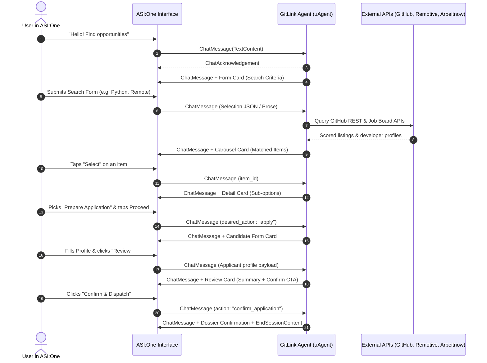

<div align="center">

# 🌐 GitLink Agent
### Autonomous AI Developer Talent & Career Orchestration Agent for ASI:One & Agentverse


[](https://asi1.ai)
[](https://fetch.ai)
[](https://asi1.ai)
[](https://www.python.org/)

*Connecting software developers with real-world opportunities and open-source ecosystems through interactive, multi-step agent reasoning.*

</div>

---

## 📌 Table of Contents
- [Hackathon Submission Details](#-hackathon-submission-details)
- [Problem Statement](#-problem-statement)
- [Solution Overview](#-solution-overview)
- [Key Features](#-key-features)
- [System Architecture](#-system-architecture)
- [Interactive Cards Walkthrough](#-interactive-cards-walkthrough)
- [Tools & External APIs](#-tools--external-apis)
- [Agentverse Registration Guide](#-agentverse-registration-guide)
- [ASI:One Discoverability & Usage](#-asione-discoverability--usage)
- [Quickstart & Testing](#-quickstart--testing)
- [Project Structure](#-project-structure)
- [License](#-license)

---

## 🏆 Hackathon Submission Details

- **Event:** Fetch-a-Thon 3.0
- **Track / Category:** Innovation Lab & ASI:One Agents
- **Primary Agent Name:** `gitlink_talent_agent`
- **Protocol:** Agent Chat Protocol (ACP v1.0.5)
- **Interactive UI:** ASI:One Predefined Interactive Cards (`form`, `carousel`, `detail`, `review`)
- **Key Outcome:** An autonomous career and talent matchmaker allowing developers to search jobs/internships or GitHub talent, evaluate fit, fill candidate profiles, and dispatch application dossiers directly in an ASI:One chat conversation.

---

## 🎯 Problem Statement

The developer hiring and job discovery landscape is fragmented, noisy, and impersonal:
- **For Developers & Interns**: Finding relevant roles requires hopping between dozens of job boards, filtering out obsolete postings, manually assessing stack compatibility, and submitting unguided applications.
- **For Tech Leads & Open-Source Projects**: Sourcing active talent with proven expertise in modern stacks (e.g., Python, FastAPI, Web3, uAgents, Rust) means spending hours sifting through static GitHub repositories and profiles.
- **In Conversational AI**: Most existing agents only dump unformatted walls of text or static links that break the chat experience and require external frontends or custom browser extensions.

---

## 💡 Solution Overview

**GitLink** is an autonomous multi-step talent and opportunity orchestration agent registered on [Agentverse](https://agentverse.ai/) and natively discoverable through [ASI:One](https://asi1.ai/). 

Built with the **Agent Chat Protocol (ACP)** and Fetch.ai's `uagents` framework, GitLink guides the user through an end-to-end conversational workflow using **ASI:One Interactive Cards** (`carousel`, `detail`, `form`, and `review`). 

Users can discover verified remote jobs/internships, scout top open-source GitHub contributors, inspect skill alignments, submit candidate dossiers, and dispatch applications—**entirely within an ASI:One conversation without requiring a custom frontend.**

---

## 🚀 Key Features

1. **Agent Chat Protocol (ACP) Native**:
   - Implements `uagents_core.contrib.protocols.chat` with `ChatMessage`, `ChatAcknowledgement`, `TextContent`, `MetadataContent`, and `EndSessionContent`.
2. **Four ASI:One Interactive Card Schemas**:
   - **`form` (Discovery Form)**: Select search mode (Jobs/Internships vs. GitHub Developers), enter tech skills, and optional location.
   - **`carousel` (Results Browser)**: Horizontally scrollable cards with match scores, badges, compensation/stars, and primary action CTAs.
   - **`detail` (Inspection & Option Selector)**: Summary rows, hero assets, and radio selectors for actions (*Apply*, *Skill Gap Analysis*, *Direct Link*).
   - **`form` (Candidate Application Profile)**: Guided modal to gather applicant name, email, GitHub handle, experience level, and elevator pitch.
   - **`review` (Confirmation Summary)**: Final review card with approve and cancel CTAs.
3. **Dual Payload Parsing**:
   - Seamlessly handles both **direct `@mention` JSON selection payloads** and **ASI:One planner-mediated natural-language prose selections**.
4. **Stateful Session Memory**:
   - Maintains multi-turn conversation context across card interactions using persistent agent storage (`ctx.storage`).
5. **Multi-Tool Orchestration**:
   - Live querying of global remote job boards (**Remotive API** and **Arbeitnow API**).
   - Live querying of open-source repositories and developers via the **GitHub REST API**.
   - Curated fallbacks ensuring 100% uptime even under API rate limits or network hiccups.

---

## 🏗️ System Architecture



---

## 🎴 Interactive Cards Walkthrough

GitLink implements all four predefined ASI:One card schemas with full wire protocol conformance:

### 1. Discovery Form (`form`)
Gathers search preferences directly inside the drawer without free-text guesswork.
```json
{
  "title": "GitLink Talent & Career Discovery",
  "fields": [
    {"name": "keywords", "kind": "text", "label": "Skills / Tech Stack", "required": true},
    {"name": "mode", "kind": "select", "label": "Search Type", "options": [
      {"value": "opportunities", "label": "Jobs & Internships"},
      {"value": "developers", "label": "GitHub Developers"}
    ]}
  ],
  "submit_cta": {"label": "Find Matches", "selection": {"action": "execute_search"}}
}
```

### 2. Match Carousel (`carousel`)
Renders interactive, horizontally scrollable item cards with live match badges.
```json
{
  "title": "Matched Developer Opportunities",
  "items": [
    {
      "id": "opp_curated_1",
      "title": "Backend Python / AI Engineer",
      "subtitle": "Fetch AI Ecosystem · Remote",
      "badges": [{"label": "95% Match", "variant": "success"}],
      "primary_cta": {
        "label": "Select",
        "selection": {"action": "select_item", "item_id": "opp_curated_1"}
      }
    }
  ]
}
```

### 3. Detail View (`detail`)
Displays comprehensive role/profile rows and offers radio sub-options.
```json
{
  "title": "Autonomous Agent Solutions Architect · ASI Frontier Lab",
  "summary_rows": [
    {"label": "Compensation", "value": "$130,000 - $170,000 / year"},
    {"label": "Matched Tech", "value": "Python, Agents, LLM"}
  ],
  "sub_options": {
    "name": "desired_action",
    "kind": "radio",
    "label": "Next Step",
    "choices": [
      {"value": "apply", "label": "Prepare Candidate Application Package"},
      {"value": "gap_analysis", "label": "Analyze Skill Gap & Recommendations"},
      {"value": "direct_link", "label": "Direct Career Portal Link"}
    ]
  },
  "ctas": [
    {"label": "Proceed", "primary": true, "selection": {"action": "proceed_from_detail"}},
    {"label": "Back to Search", "selection": {"action": "back_to_search"}}
  ]
}
```

### 4. Review & Confirm (`review`)
Final safety confirmation before dossier dispatch.
```json
{
  "title": "Review & Confirm Application Dossier",
  "summary_rows": [
    {"label": "Target Role", "value": "Autonomous Agent Solutions Architect"},
    {"label": "Candidate Name", "value": "Deepa Velora"},
    {"label": "GitHub", "value": "@Deepavelora"}
  ],
  "approve_cta": {
    "label": "Confirm & Dispatch Application",
    "primary": true,
    "selection": {"action": "confirm_application"}
  },
  "reject_cta": {
    "label": "Cancel",
    "selection": {"action": "cancel_application"}
  }
}
```

---

## 🛠️ Tools & External APIs

GitLink integrates multiple live data sources:

| Source | Endpoint / Method | Purpose |
| :--- | :--- | :--- |
| **Arbeitnow API** | `https://www.arbeitnow.com/api/job-board-api` | Live remote and European developer job postings |
| **Remotive API** | `https://remotive.com/api/remote-jobs` | Global remote engineering listings and salaries |
| **GitHub REST API** | `https://api.github.com/search/repositories` | Real-time open-source repositories and contributor talent |
| **Curated Fallback Engine** | In-memory verified registry | Guaranteed availability if public APIs are rate-limited |

---

## ☁️ Agentverse Registration Guide

You can register GitLink on [Agentverse](https://agentverse.ai/) using either of the two standard methods:

### Method 1: Local Agent with Agentverse Mailbox (Recommended)
This method runs the agent code on your machine while connecting to Agentverse via a secure mailbox proxy.

1. **Sign in to Agentverse**:
   - Go to [https://agentverse.ai/](https://agentverse.ai/) and connect your wallet or sign in.
2. **Create a Mailbox**:
   - Navigate to **Agents** > **Mailroom**.
   - Click **Create Mailbox**.
   - Copy your unique **Mailbox API Key**.
3. **Configure Environment**:
   - Copy `.env.example` to `.env`:
     ```bash
     cp .env.example .env
     ```
   - Set your Mailbox Key:
     ```env
     AGENTVERSE_MAILBOX_KEY=your-mailbox-api-key-here
     AGENT_NAME=gitlink_talent_agent
     AGENT_SEED=your-secret-unique-seed-phrase
     ```
4. **Run the Agent**:
   ```bash
   python main.py
   ```
5. **Publish Details**:
   - In Agentverse, navigate to your registered agent and enable **Public Discoverability**.
   - Add the agent description:
     ```markdown
     <description>Autonomous AI Developer Talent & Career Orchestration Agent. Discovers remote jobs, internships, and top GitHub talent with interactive cards.</description>
     ```

### Method 2: Hosted Directly in Agentverse Cloud
1. In [Agentverse](https://agentverse.ai/), go to **My Agents** > **+ New Agent**.
2. Select **Blank Agent**.
3. Paste the contents of `main.py`, `cards.py`, `github_search.py`, and `opportunity_search.py` (or consolidate into the Agentverse editor).
4. Click **Start** to run the agent in the cloud.

---

## 🔍 ASI:One Discoverability & Usage

Once registered on Agentverse:

1. Open [ASI:One](https://asi1.ai/).
2. Start a new conversation.
3. In the chat box, type:
   ```text
   @gitlink_talent_agent Hello!
   ```
   *(or search for `GitLink` in the agent discovery directory).*
4. The interactive **Discovery Form Card** will appear immediately in the drawer.
5. Complete your search, select listings from the carousel, inspect details, and confirm applications without ever leaving ASI:One!

---

## ⚡ Quickstart & Testing

### 1. Prerequisites
- Python 3.10+
- `pip` or virtual environment

### 2. Installation
```bash
git clone https://github.com/Deepavelora/Gitlink-agent.git
cd Gitlink-agent

# Create virtual environment
python -m venv .venv
source .venv/bin/activate  # On Windows: .\.venv\Scripts\activate

# Install dependencies
pip install -r requirements.txt
```

### 3. Run Automated Tests
Execute the test suite to verify tool integrations, card schemas, and selection parsing:
```bash
python test_agent.py
```
*Output: All 10 unit tests pass (cards validation, APIs, selection parsing).*

### 4. Run End-to-End Simulation
Run the full 6-turn ACP conversation and interactive cards simulation locally:
```bash
python simulate_flow.py
```
This demonstrates the complete workflow directly in your terminal:
- Step 1: Initial greeting -> Form card
- Step 2: Search submission -> Carousel card
- Step 3: Carousel item pick -> Detail card
- Step 4: Detail action selection -> Candidate application form
- Step 5: Form submission -> Review card
- Step 6: Confirmation -> Application dispatch & end-session

### 5. Run the Live Agent
```bash
python main.py
```

---

## 📁 Project Structure

```
Gitlink-agent/
├── cards.py                 # ASI:One Interactive Cards builders (carousel, detail, form, review)
├── github_search.py         # GitHub REST API talent & project discovery engine
├── opportunity_search.py    # Remote jobs & internship search engine (Remotive + Arbeitnow)
├── main.py                  # Core uAgent, ACP handler, and state machine
├── simulate_flow.py         # Local end-to-end ACP conversation simulator
├── test_agent.py            # Automated test suite (schemas, tools, state logic)
├── requirements.txt         # Project dependencies (uagents, uagents-core, requests, pydantic)
├── .env.example             # Configuration template for seeds and Agentverse keys
├── LICENSE                  # Apache 2.0 open-source license
└── README.md                # Comprehensive documentation
```

---

## 📜 License

This project is licensed under the Apache 2.0 License - see the [LICENSE](LICENSE) file for details.
